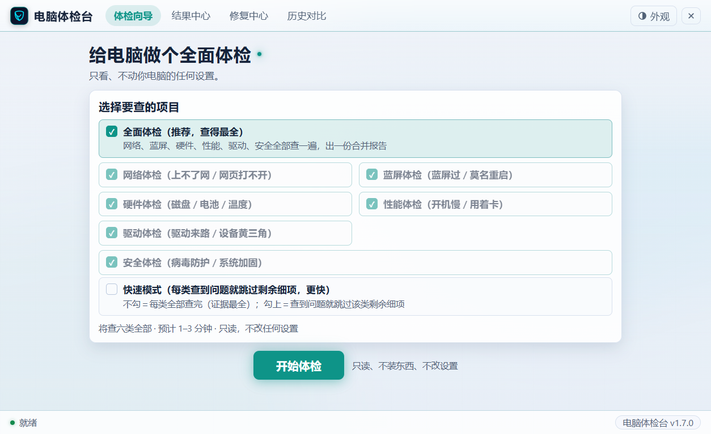
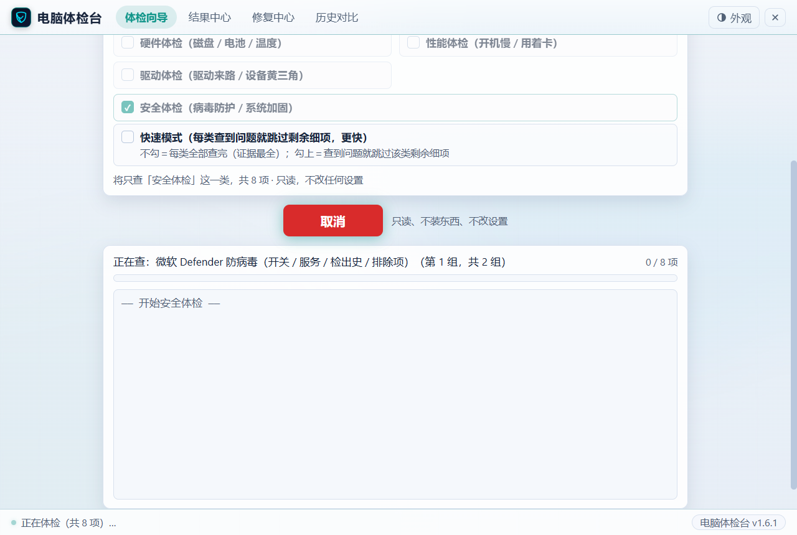
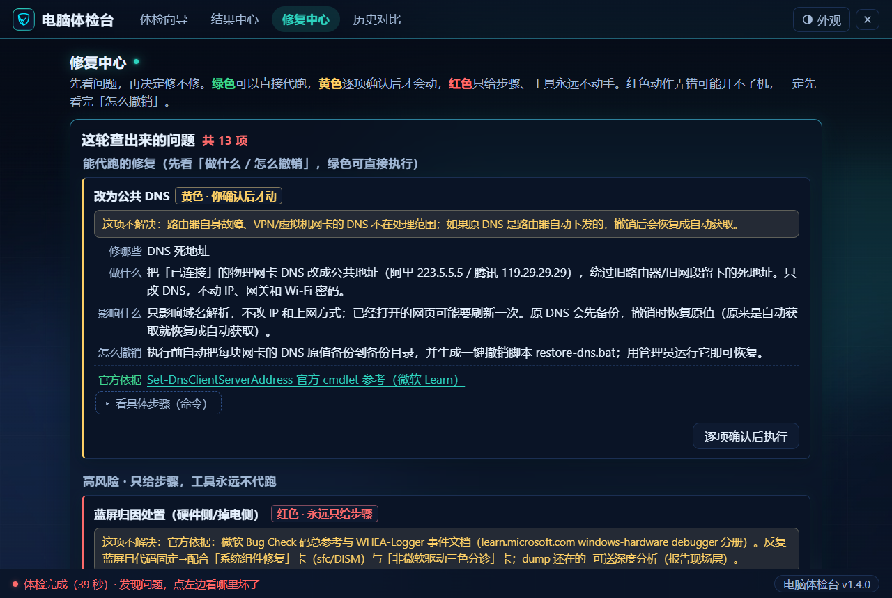
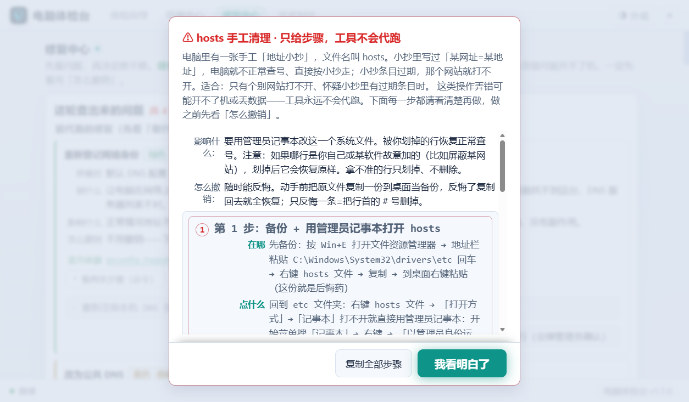
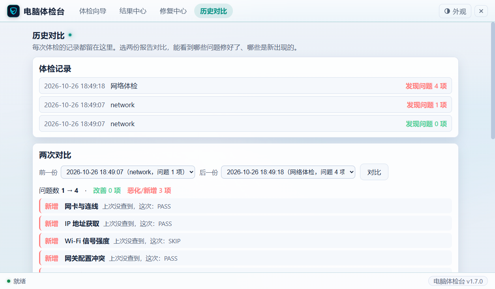

# 电脑体检台（PC Checkup Bench）

**[English](README_EN.md)** | 中文

> 一个免费的 Windows 体检工具：**只看、不动你电脑的任何设置**。52 项只读检查把「网络 / 蓝屏 / 硬件 / 性能 / 驱动 / 安全」六类问题查清楚，每一项都给出：问题在哪、证据是什么、怎么修、修的依据是微软哪篇官方文档。

[](https://github.com/Mrxiaobbbaiii/pc-checkup-bench/actions/workflows/ci.yml)   

| 体检向导 | 跑批中 |
|---|---|
|  |  |

| 结果中心（先修这个） | 修复中心 |
|---|---|
|  |  |

| 红卡分步指南（五要素） | 历史对比 |
|---|---|
|  |  |

## 它能帮你做什么

- **不知道电脑哪里有毛病** → 跑一轮全面体检（约 1–3 分钟），出一份按「高 / 中 / 低」排好序的问题清单
- **同一类问题反复出现** → 「先修这个」会把同一个病根引起的多项报警合并成一个行动项，按「值得先修的程度」排序，一键跳到处理办法
- **查出来了不会修** → 修复中心三档分工：**绿色**安全小修工具代跑（跑完自动复查）；**黄色**你逐项确认后才动、动手前自动备好撤销包；**红色**高风险操作永远只给一步一步的指南（在哪 / 点什么 / 输入什么 / 看到什么算成功 / 失败了先干什么），工具绝不代跑
- **要自己动手的步骤找不到入口** → 「一键直达系统窗口」8 个按钮，先把设备管理器、服务、系统保护这些窗口替你打开
- **想知道修没修好** → 修复后自动复查 + 历史对比（两次报告逐项对比：哪些修好了、哪些是新冒出来的）

## 检查与修复一览

| 体检树 | 查什么 | 项数 |
|---|---|---|
| 网络体检 | 网卡 / IP / 网关 / 公网 / DNS / 代理 hosts VPN / Wi-Fi 信号 / 大包传输 | 15 |
| 蓝屏体检 | 近 90 天蓝屏记录 / 蓝屏码频次 / 硬件报错（WHEA）/ 嫌疑驱动名单 | 6 |
| 硬件体检 | 磁盘健康 / SMART 预警 / 文件系统错误 / 电池损耗 / 温度 / 内存诊断史 | 7 |
| 性能体检 | 开机用时 / 自启项 / 服务超时 / 磁盘空间与繁忙度 / 内存压力 / 应用崩溃 | 9 |
| 驱动体检 | 驱动签名 / 古董驱动 / 网络过滤层 / 设备黄三角 / 驱动加载失败 | 7 |
| 安全体检 | Defender 防病毒（开关 / 服务 / 检出史 / 排除项）/ UAC / 防火墙 / BitLocker / 计划任务 | 8 |

「安全体检」查的是防中毒的两道防线：微软 Defender 杀毒防护（防护开关 / 服务 / 近 30 天检出史 / 查杀排除项）和系统加固（UAC 档位 / 防火墙 / 磁盘加密 / 计划任务）——8 项全部只读，安全设置只给人工核对路径，工具永不代改。

- 修复动作 25 个：绿色 6（可代跑）/ 黄色 9（确认后代跑）/ 红色 10（只给分步指南）
- 每个修复办法都附**微软官方文档出处**，可点开核对
- 支持 ext 扩展口子：自己的检查脚本、体检树、修复指南放进 `ext/` 文件夹即可生效，不用重新打包

## 安装

### 方式一：安装包（推荐）

1. 到 [Releases](../../releases) 下载最新的 `PC-CheckupBench-setup-v1.6.1.exe`
2. 双击运行。第一次会弹 Windows 蓝色提示「已保护你的电脑」——本工具没有购买代码签名证书，这是对无签名程序的通用提醒。点 **「更多信息」→「仍要运行」** 即可
3. 安装不需要管理员权限，装到你的用户目录，桌面和开始菜单会出现「电脑体检台」图标
4. 打开的是原生窗口（不是浏览器页面），关窗即完全退出，不留后台进程
5. 卸载走「设置 → 应用」：卸载前会自动把你的体检报告、修复记录备份到旁边的文件夹，不会丢

> 少数精简版系统可能缺 Edge WebView2 组件（显示界面的内核），程序会自动检测并弹窗引导你到微软官方页下载，装完再双击图标即可。Windows 10/11 一般自带，无需操心。

### 方式二：绿色版（免安装）

1. 下载 `diag-lite-v1.6.1.zip`，解压到任意位置（桌面也行）
2. 双击「全面体检（网页版）.bat」出窗口界面；或双击六类体检任一 `.bat` 直接跑黑窗口版
3. 需要 Windows 10/11（自带 Edge 浏览器即可）

## 三步上手

1. **点「开始体检」**——默认全面体检，不用改
2. **等 1–3 分钟**——进度条跑完自动出报告
3. **去「修复中心」照提示修**——绿色一键执行，红色照步骤来

## 自定义外观与背景

### 明暗与强调色

点右上角的**外观按钮**（悬停提示「外观：明暗、强调色、背景原画」）：

- **明暗**三档：自动跟随系统 / 深色 / 浅色。选「自动」时，跟着系统的明暗实时切换
- **强调色**：六种颜色任选，界面高亮处（比如当前选中的选项）跟着换
- **语言**：中文 / English 随时切换

选择存在本机，关掉重开保持不变。菜单里也有**「恢复默认外观」**，一键回到出厂配色。

### 背景原画

深色 / 浅色主题各配一张**程序生成**的背景图（无版权限制）。点外观按钮 → **「看背景大图」**即可查看两幅原图。

### 自换背景图

想用自己的图当背景：

1. 找到安装目录里的 `ui\` 文件夹（默认 `C:\Users\<用户名>\AppData\Local\电脑体检台\ui\`；绿色版在解压出的文件夹里）
2. 把自备的图改名覆盖进去：`bg.jpg`（深色主题用）/ `bg-light.jpg`（浅色主题用）
3. 重开应用，新背景就位

想恢复默认：重装一次，或从官方发布包里把这两张原图解回来。

> **提醒：升级安装会覆盖 `ui` 目录，自换的图请先备份。**

## 只读承诺

体检全程**只读**：只调用 Windows 自带的查看类命令（`ping` / `nslookup` / `Get-WinEvent` / `Get-PhysicalDisk` 等），不装任何东西、不改任何设置、不写注册表。

只有一种情况工具会动手：你亲自进入修复中心、亲自点了「执行」按钮。而且：

- 绿色 = 完全可逆的小修，跑完自动复查
- 黄色 = 动手前自动生成撤销包（含撤销脚本）和可选系统还原点，你逐项打勾确认才跑
- 红色 = 工具永远不动手，只给步骤

每次修复都记入本机记录（`reports/repair-log.json`），修了什么、成没成，随时可查。

## 免责声明

本工具按「现状」提供，体检结论与修复建议仅供参考。红色级操作弄错可能开不了机或丢数据——执行前务必看清每一步和「怎么撤销」。重要数据请先备份。

## 关于开发方式

本项目由 AI 辅助开发（vibe coding with [ZCode](https://zcode.ai) / GLM）：从需求梳理、方案设计、代码实现到测试回归，全程人机协作完成，人类负责拍板与验收。全部检查逻辑、测试用例（242 项断言 × PowerShell 5.1 / 7 双版本、UI 自动化 35 项）随源码公开，欢迎审查。

## 从源码运行

```powershell
git clone <仓库地址>
cd <仓库目录>
powershell -NoProfile -ExecutionPolicy Bypass -File server.ps1   # 网页版（浏览器打开）
```

或构建安装包（需要 .NET Framework csc + Inno Setup 6/7）：

```powershell
powershell -NoProfile -ExecutionPolicy Bypass -File build.ps1 -Setup
```

## 目录结构

```
├─ engine/ checks/ trees/   # 检查引擎、52 项检查脚本、六棵体检树定义
├─ repair/                  # 修复动作（绿/黄/红三档，含官方文档出处）
├─ ui/                      # 界面（HTML/CSS/JS，零依赖零 CDN，断网可用）
├─ server.ps1               # 本地服务（起界面+调度引擎）
├─ host/                    # 原生窗口壳（C#，WebView2）
├─ ext/                     # 扩展口子：自定义检查/树/修复指南
└─ tests/                   # 242 项断言 + UI 自动化回归
```
