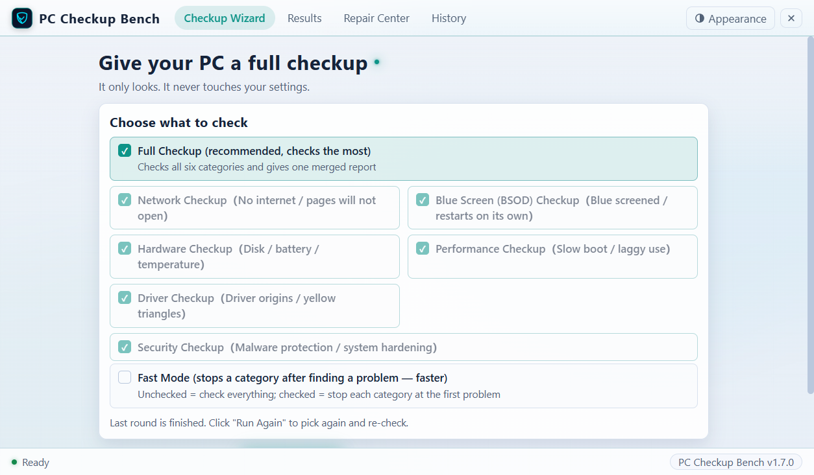
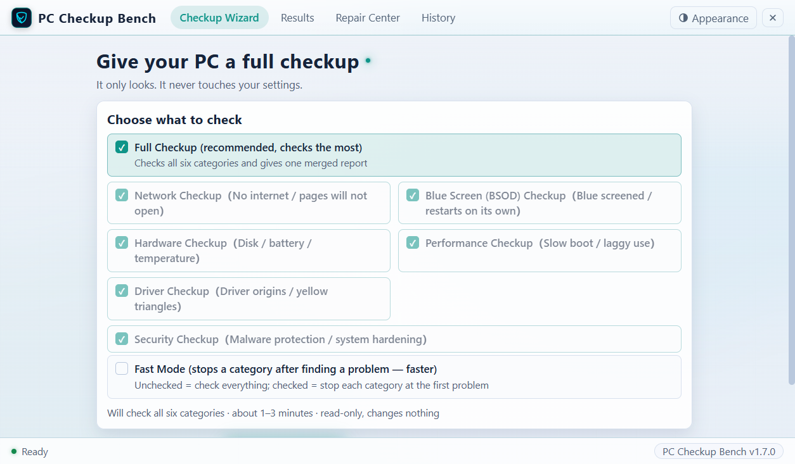
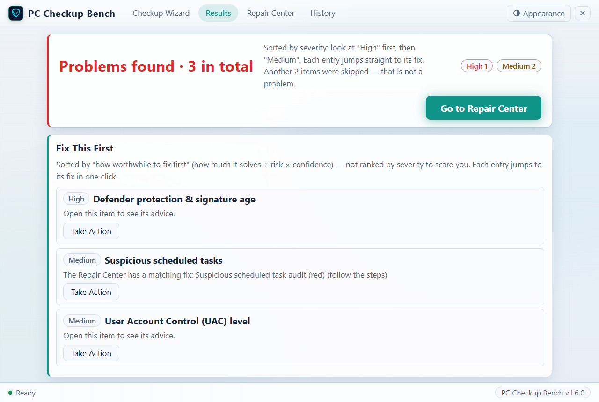
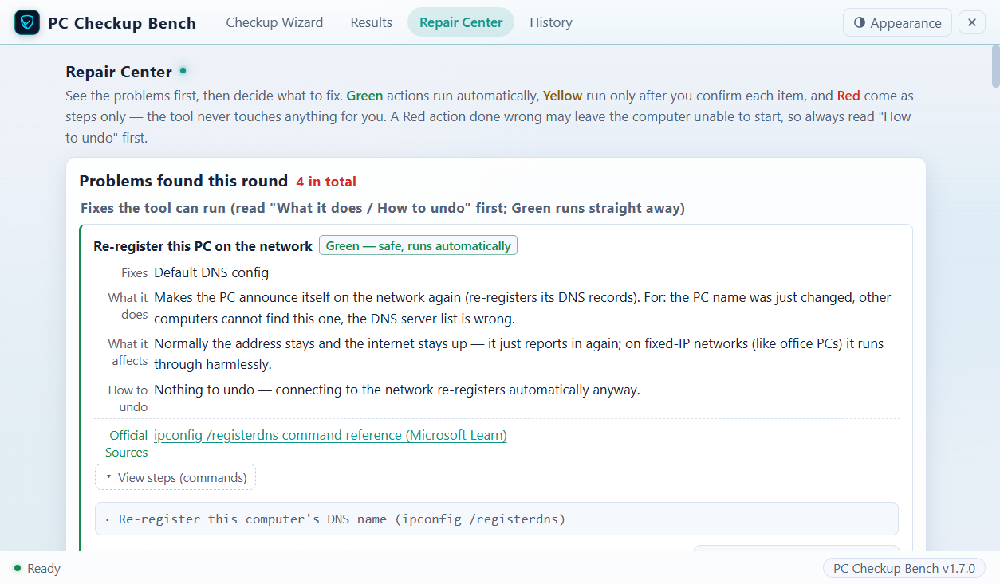
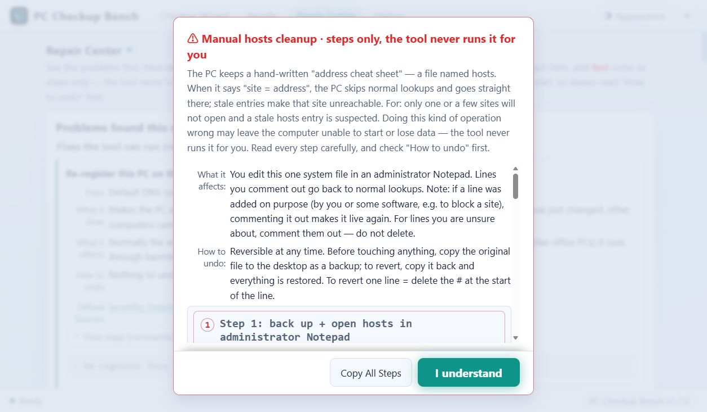
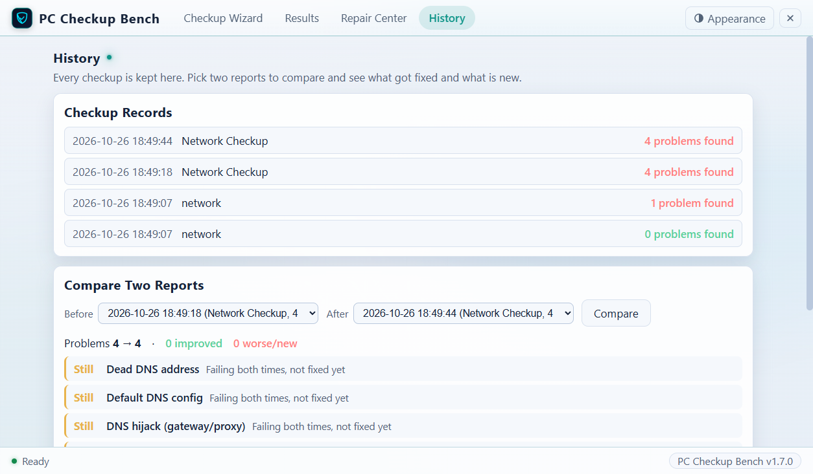

# PC Checkup Bench

English | **[中文](README.md)**

> A free Windows checkup tool: **It only looks. It never touches your settings.** 52 read-only checks cover six categories — Network / Blue Screen / Hardware / Performance / Driver / Security — and for every item it tells you: where the problem is, what the evidence is, how to fix it, and which official Microsoft document the fix is based on.

[](https://github.com/Mrxiaobbbaiii/pc-checkup-bench/actions/workflows/ci.yml)   

| Checkup Wizard | During a Checkup |
|---|---|
|  |  |

| Results (Fix This First) | Repair Center |
|---|---|
|  |  |

| Red-Card Step-by-Step Guide | History |
|---|---|
|  |  |

## What It Helps You With

- **Don't know what's wrong with your computer** → Run a Full Checkup (about 1–3 minutes) and get a problem list sorted by High / Medium / Low severity
- **The same kind of problem keeps coming back** → "Fix This First" merges the alerts that share one root cause into a single action item, ranked so the most worthwhile fix comes first, and jumps straight to the fix with one click
- **A problem was found but you don't know how to fix it** → The Repair Center splits the work into three tiers: **Green** — safe small fixes the tool runs for you (with an automatic re-check afterwards); **Yellow** — nothing is touched until you confirm each item, and an undo package is prepared automatically before any change; **Red** — high-risk actions always come only as a step-by-step guide (Where / Click / Type / Success looks like / If this step fails), and the tool never runs them for you
- **Can't find the windows you need to work in yourself** → 8 "One-click System Windows" buttons open Device Manager, Services, System Protection and other windows for you first
- **Want to know whether a fix actually worked** → automatic re-check after fixes + History (two reports compared item by item: what got fixed, and what is newly showing up)

## Checks and Repairs at a Glance

| Checkup Tree | What it checks | Items |
|---|---|---|
| Network Checkup | network adapter / IP / gateway / public internet / DNS / proxy, hosts and VPN / Wi-Fi signal / large packet transfer | 15 |
| Blue Screen (BSOD) Checkup | blue screen records from the last 90 days / blue screen code frequency / hardware errors (WHEA) / suspect driver list | 6 |
| Hardware Checkup | disk health / SMART warnings / file system errors / battery wear / temperature / memory diagnostic history | 7 |
| Performance Checkup | boot time / startup items / service timeouts / disk space and busyness / memory pressure / app crashes | 9 |
| Driver Checkup | driver signature / ancient drivers / network filter drivers / devices with a yellow warning triangle / driver load failures | 7 |
| Security Checkup | Microsoft Defender antivirus (switches / services / detection history / exclusions) / UAC / firewall / BitLocker / scheduled tasks | 8 |

The Security Checkup looks at the two lines of defense against malware: Microsoft Defender antivirus protection (protection switches / services / detections in the last 30 days / scan exclusions) and system hardening (UAC level / firewall / disk encryption / scheduled tasks) — all 8 checks are read-only, and for security settings the tool only shows you the manual path, never changes anything itself.

- 25 repair actions: Green 6 (run for you) / Yellow 9 (run for you after your confirmation) / Red 10 (step-by-step guide only)
- Every fix comes with its **official Microsoft documentation source**, which you can open and check
- Custom checks are supported: put your own check scripts, checkup trees, and repair guides into the `ext/` folder and they take effect — no repackaging needed

## Install

### Option 1: Installer (Recommended)

1. Go to [Releases](../../releases) and download the latest installer `PC-CheckupBench-setup-v1.8.3.exe`
2. Double-click to run it. The first time, Windows shows a blue prompt saying "Windows protected your PC" — this tool has no paid code-signing certificate, so this is the generic warning for unsigned programs. Click **More info → Run anyway**
3. Installing needs no administrator rights. It installs into your user folder, and a "PC Checkup Bench" icon appears on the desktop and in the Start menu
4. What opens is a native window (not a browser page). Closing the window exits completely — no background processes left behind
5. Uninstall through "Settings → Apps": before uninstalling, your checkup reports and repair records are automatically backed up to a backup folder next to the app folder, so nothing is lost

> A few slimmed-down Windows editions may lack the Edge WebView2 component (the engine that displays the interface). The program detects this automatically and pops up a guide to the official Microsoft download page; after installing it, double-click the icon again. Windows 10/11 normally include it, so there is nothing to worry about.

### Option 2: Portable Version (No Install Needed)

1. Download `diag-lite-v1.8.3.zip` and extract it anywhere (the desktop is fine)
2. Double-click `全面体检（网页版）.bat` to get the windowed interface; or double-click any one of the six checkup `.bat` files to run the console version directly
3. Requires Windows 10/11 (the built-in Edge browser is enough)

## Quick Start

1. **Click "Start Checkup"** — the default is Full Checkup, no need to change anything
2. **Wait 1–3 minutes** — when the progress bar finishes, the report opens automatically
3. **Go to the "Repair Center" and fix things as prompted** — Green runs with one click; for Red, follow the steps

## Customizing the Look & Background

### Theme and Accent Color

Click the **appearance button** in the top-right corner (its tooltip reads "Appearance: theme, accent color, background art"):

- **Theme**, three settings: Auto (follows your system) / Dark / Light. With Auto, the interface switches in real time when your system theme changes
- **Accent color**: pick any of the six swatches and the highlights across the interface (such as the currently selected option) follow along
- **Language**: switch between Chinese and English anytime

Your choice is stored on this machine and is kept when you close and reopen the app. The menu also has **"Reset appearance"** to restore the factory colors in one click.

### The Background Art

Each theme (dark / light) comes with a **procedurally generated** background image — no copyright restrictions. To see both originals, click the appearance button → **View background art**.

### Bring Your Own Background

1. Find the `ui\custom\` folder in the install directory (by default `C:\Users\<your-user-name>\AppData\Local\电脑体检台\ui\custom\`; create it if it does not exist; for the portable version it is inside the extracted folder)
2. Put your own image there and rename it: `bg.jpg` (used by the dark theme) / `bg-light.jpg` (used by the light theme)
3. Reopen the app and the new background is in place; the "View background art" dialog shows your own images too

To go back to the defaults: delete the matching image from `ui\custom\` and reopen the app.

> **An upgrade install never touches `ui\custom\`** — your own background survives upgrades.

## Read-Only Promise

The whole checkup is **read-only**: it only runs the viewing commands built into Windows (`ping` / `nslookup` / `Get-WinEvent` / `Get-PhysicalDisk` etc.). It installs nothing, changes no settings, and writes nothing to the registry.

There is only one case where the tool acts: you personally go into the Repair Center and personally click the "Run" button. And even then:

- Green = fully reversible small fixes, with an automatic re-check afterwards
- Yellow = an undo package (with undo script) and an optional system restore point are generated automatically before anything is touched, and it runs only after you tick and confirm each item
- Red = the tool never acts, it only gives you the steps

Every repair is recorded in a local log (`reports/repair-log.json`) — what was repaired and whether it succeeded, checkable at any time.

## Disclaimer

This tool is provided "as is". Checkup results and repair suggestions are for reference only. A Red-level action done wrong may leave the computer unable to start or may lose data — before running one, read every step and the "how to undo" part carefully. Back up important data first.

## About How This Project Was Built

This project was built with AI-assisted development (vibe coding with [ZCode](https://zcode.ai) / GLM): from sorting out requirements, solution design, and code implementation to test regression, everything was done in human-machine collaboration, with humans making the final calls and accepting the results. All check logic and test cases (242 assertions × PowerShell 5.1 / 7 dual versions, 35 UI automation tests) are public with the source code. Review is welcome.

## Run from Source

```powershell
git clone <repo URL>
cd <repo folder>
powershell -NoProfile -ExecutionPolicy Bypass -File server.ps1   # Web version (opens in browser)
```

Or build the installer (requires .NET Framework csc + Inno Setup 6/7):

```powershell
powershell -NoProfile -ExecutionPolicy Bypass -File build.ps1 -Setup
```

## Directory Structure

```
├─ engine/ checks/ trees/   # check engine, 52 check scripts, definitions of the six checkup trees
├─ repair/                  # repair actions (green/yellow/red tiers, with official documentation sources)
├─ ui/                      # UI (HTML/CSS/JS, zero dependencies, zero CDN, works offline)
├─ server.ps1               # local server (starts the UI and dispatches the engine)
├─ host/                    # native window shell (C#, WebView2)
├─ ext/                     # extensions: custom checks/trees/repair guides
└─ tests/                   # 242 assertions + UI automation regression
```
